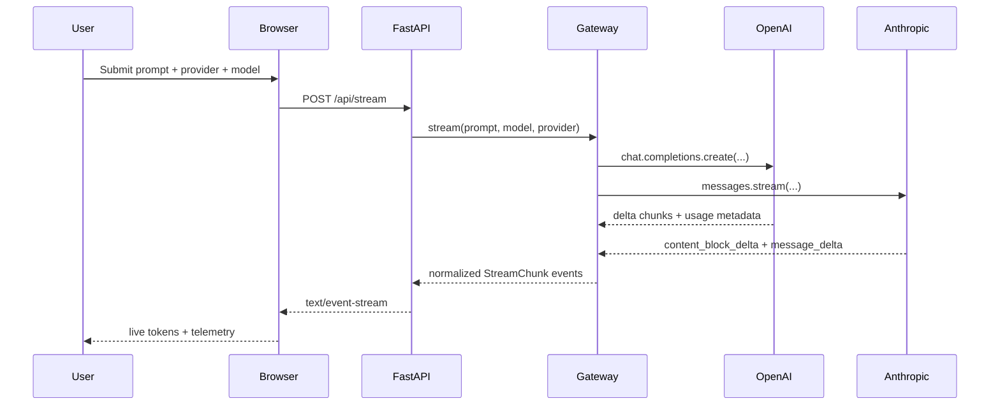

# Multi-Provider LLM Gateway

## AD331 course repo layout

This repository is structured to support multiple projects across the AD331 term. Each assignment lives in its own directory under `projects/` so the work stays organized and isolated.

```text
AD331/
├── README.md
├── projects/
│   ├── README.md
│   ├── week-03-resilient-unstructured-data-extraction-pydantic-validation-pipelines/
│   │   ├── README.md
│   │   ├── src/
│   │   ├── tests/
│   │   └── notebooks/
│   └── week-04-multi-provider-async-llm-gateway-real-time-telemetry-engine/
│       ├── README.md
│       ├── src/
│       ├── tests/
│       └── pyproject.toml
├── .venv/
├── .env
├── pyproject.toml
└── .git/
```

This keeps course work organized while reflecting the actual week sequencing used in the repo.

---

A production-oriented Python gateway for streaming responses across OpenAI and Anthropic while normalizing token telemetry and pricing into a single SDK surface.

## Overview

The project exposes a unified `UnifiedLLMGateway` that hides provider-specific differences behind a single async generator API, emits normalized `StreamChunk` events, and calculates live token/cost telemetry in real time.



## Features

- Async streaming with provider-neutral `AsyncGenerator[StreamChunk, None]`
- Pydantic v2 validation for chunk payloads and telemetry
- OpenAI and Anthropic support with normalized event parsing
- Real-time TTFT, tokens/sec, token counts, and cost telemetry
- Secret-safe error handling and validation for missing API keys
- FastAPI interface for local streaming demo

## Prerequisites

- Python 3.11+
- `uv` or `pip`
- OpenAI API key and/or Anthropic API key

## Setup

```bash
python3 -m venv .venv
source .venv/bin/activate
python -m pip install --upgrade pip
python -m pip install -e '.[dev]'
cp .env.example .env
```

Then add your API keys in `.env`:

```bash
OPENAI_API_KEY=your_openai_key_here
ANTHROPIC_API_KEY=your_anthropic_key_here
```

## Running the app

```bash
uvicorn src.app:app --host 0.0.0.0 --port 8000 --reload
```

Open http://localhost:8000 in a browser.

## Running tests

```bash
pytest -v
```

## Pricing matrix

| Provider | Model | Input cost ($/1M tokens) | Output cost ($/1M tokens) |
| --- | --- | ---: | ---: |
| OpenAI | gpt-4o | 5.00 | 15.00 |
| OpenAI | gpt-4o-mini | 0.15 | 0.60 |
| Anthropic | claude-3-5-sonnet | 3.00 | 15.00 |
| Anthropic | claude-3-5-haiku | 0.80 | 4.00 |

## Audit and verification summary

The initial AI-generated draft was audited for async misuse, final-chunk parsing problems, and provider-specific telemetry drift. The finalized code resolves these issues by:

- using `AsyncOpenAI` / `AsyncAnthropic` clients only in async execution paths
- guarding final usage chunks where `choice.delta.content` is `None`
- handling Anthropic `message_start`, `content_block_delta`, and `message_delta` event types explicitly
- computing TTFT from the first non-empty delta rather than the network handshake
- rounding total cost to six decimal places using `Decimal`
- keeping client instances on the gateway instance instead of reinitializing inside each call
- sanitizing exceptions to redact API key material before exposing them to logs or the UI

## License

MIT
