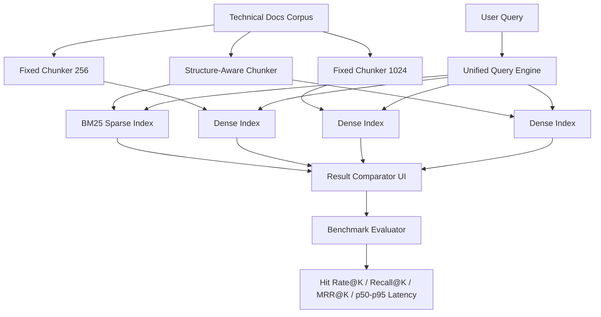

# Week 05: Semantic Document Search Engine & Empirical Retrieval Benchmarking

This project implements a modular semantic search workbench for technical documentation with comparative evaluation of sparse lexical retrieval (BM25) and dense vector retrieval across chunking strategies.

## Project Architecture



## Repository Layout

```text
week-05-semantic-document-search-engine-empirical-retrieval-benchmarking/
├── pyproject.toml
├── .env.example
├── .gitignore
├── README.md
├── ai_prompt_log.md
├── Dockerfile
├── docker-compose.yml
├── corpus/
│   ├── 01_api_gateway.md ... 20_search_architecture.md
│   └── api_spec_sample.md
├── data/
│   └── eval_queries.json
├── src/
│   ├── __init__.py
│   ├── chunking.py
│   ├── indexer.py
│   ├── search.py
│   ├── benchmarker.py
│   └── app.py
└── tests/
    ├── __init__.py
    ├── test_chunking.py
    ├── test_retrieval.py
    └── test_benchmarks.py
```

## Setup (uv + Python 3.11)

1. Initialize environment:
   - `uv python pin 3.11`
   - `uv sync`

2. (Optional) add OpenAI key in `.env` if you switch to hosted embeddings.

## Corpus & Evaluation Dataset

- Corpus: 21 Markdown documents: 20 original, AI-assisted reference pages (approximately 8,200 words in total) about Meridian, a **fictional** documentation platform, plus the original API specification sample. Each numbered file is a self-contained documentation page, not a measured printed page; examples and configuration values are illustrative, not authoritative vendor documentation.
- Topics span gateways, identity, rate limiting, deployment, service discovery, TLS, DNS, HTTP retries, pooling, caches, batching, queues, idempotency, SQL transactions, sharding, relational indexes, backups, observability, incident response, and search architecture. The original sample preserves existing evaluation labels.
- Evaluation set: `data/eval_queries.json`
  - 15 labeled queries
  - Mix of lexical/entity-exact and semantic/conceptual intents
  - All existing labels refer to sections of the original sample, not the 20 new pages. Related passages in the new pages have not been independently judged, so scores may count relevant results as misses. Expand and review labels across the corpus before using results as empirical findings.
  - Labels use section keys rather than chunk offsets; fixed-size chunks do not yet map those keys, so their evaluation scores are invalid. Recall also currently counts repeated hits for a section more than once. Both issues require correction before comparing strategies.

## Execution Commands

- Run Streamlit UI:
  - `streamlit run src/app.py`

- Run tests:
  - `pytest -v`

- Run containerized demo:
  - `docker compose up --build`

## Benchmark Methodology

Compared retrieval strategies:
1. BM25 baseline (structure-aware chunks)
2. Dense retrieval with fixed 256-token chunks
3. Dense retrieval with fixed 1024-token chunks
4. Dense retrieval with structure-aware chunks

Metrics:
- Hit Rate@K
- Recall@K
- MRR@K
- Latency p50/p95 (ms)

MRR definition used:
$$
\text{MRR@K} = \frac{1}{|Q|} \sum_{q \in Q} \frac{1}{\operatorname{rank}_q}
$$
where contribution is $0$ if no relevant result appears in top-$K$.

## Empirical Findings Template

| Strategy | Hit Rate@5 | Recall@5 | MRR@5 | p50 Latency (ms) | p95 Latency (ms) |
|---|---:|---:|---:|---:|---:|
| BM25 Baseline | TBD | TBD | TBD | TBD | TBD |
| Dense 256 | TBD | TBD | TBD | TBD | TBD |
| Dense 1024 | TBD | TBD | TBD | TBD | TBD |
| Dense Structure-Aware | TBD | TBD | TBD | TBD | TBD |

### Systems Reflection

Lexical retrieval should dominate exact technical lookup (identifiers, enum values, and literal API parameters), while dense retrieval should show stronger recall for paraphrased conceptual intent. Chunk size changes trade retrieval precision for semantic completeness: smaller windows can isolate exact facts, while larger windows preserve context but may dilute rank precision for point lookups.

Structure-aware chunking typically improves conceptual cohesion by preserving section boundaries and code examples, reducing semantic fragmentation caused by arbitrary token windows. Final deployment decisions should combine quality metrics and latency constraints rather than assuming dense retrieval is globally superior.

## AI Audit Log Summary

See `ai_prompt_log.md` for:
- baseline prompt,
- audited defects,
- refactor decisions,
- and validation notes.

## Video Walkthrough Checklist

- Architecture + corpus overview
- AI prompt + audit findings
- Live BM25 vs dense query comparison
- Benchmark dashboard run-through
- `pytest -v` execution with passing tests
